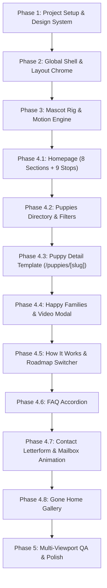

# TeddyPups Implementation Plan

This plan outlines the recommended step-by-step engineering sequence to recreate the TeddyPups website (`https://puppy.instabizweb.com/`) with pixel-level fidelity, responsive stability, and identical animation behavior.

---

## 1. Architectural Strategy

The target implementation will use:
- **Framework**: Next.js (App Router, TypeScript)
- **Styling**: Tailwind CSS configured with the exact design tokens, custom font families, colors, easings, and keyframes extracted from the reference trace.
- **Scroll & Motion**:
  - Lenis (`lenis`) for momentum-smoothed scrolling.
  - Custom React Context (`MotionProvider` / `PupJourney`) synchronizing scroll offset to the SVG mascot waypoint positions.
- **Canvas FX**: HTML5 Canvas 2D for cursor paw trails (`PawTrailCanvas`).

---

## 2. Phase-by-Phase Implementation Order

---

### Phase 1: Project Setup & Design System Tokens

**Goal**: Establish the build environment, fonts, colors, and global CSS baseline.

1. **Next.js & Tailwind Configuration**:
   - Install dependencies (`lenis`, `clsx`, `tailwind-merge`).
   - Configure `tailwind.config.ts` with custom colors:
     - `milk`: `#fffdf8`
     - `cocoa`: `#2a170e`
     - `cocoa-soft`: `#5a3a28`
     - `toffee`: `#c2622b`
     - `toffee-deep`: `#a24a1a`
     - `honey`: `#f2be6b`
     - `honey-soft`: `#fbe3b4`
     - `blush`: `#f9cdbf`
     - `sky`: `#bfddf5`
   - Configure custom font variables:
     - `--font-display`: `Fraunces`
     - `--font-sans`: `Figtree`
     - `--font-hand`: `Shantell Sans`
   - Inject the 20+ custom keyframes extracted from the reference stylesheet (`tp-curtain-*`, `tp-runner-*`, `tp-menu-*`, `tp-twinkle`, `tp-float`, `tp-stamp-*`, `tp-msg-*`, `tp-letter-*`, etc.).
2. **Global Styles (`globals.css`)**:
   - Establish CSS variables (`--gutter`, `--header-h`, `--bar-h`, `--ease-pounce`, etc.).
   - Define utility classes (`.gutter`, `.font-scrawl`, `.tp-sketch`, `.tp-stamp`, `.tp-sticker-chip`).

---

### Phase 2: Global Shell & Navigation Chrome

**Goal**: Build persistent UI elements visible across all routes.

1. **`RouteCurtain`**:
   - Implement the sliding curtain with centered running puppy character and paw print steps.
2. **`SmoothScroll`**:
   - Initialize Lenis smooth scroll provider, ensuring scroll velocity is accessible to child components.
3. **`Header` & `HeaderBehavior`**:
   - Logo lockup (`/brand/logo.png`).
   - Desktop navigation links with active state pill styling.
   - WhatsApp CTA button.
   - Mobile hamburger button.
   - Scroll-triggered frosted backdrop transition.
4. **`MobileMenu`**:
   - Fullscreen drawer with circular clip-path reveal animation (`@keyframes tp-menu-in / out`).
   - Focus trapping and scroll lock.
5. **`MobileBottomBar`**:
   - Fixed dock on `< 768px` viewports with WhatsApp and Call buttons.
6. **`Footer`**:
   - 3-column layout (Brand info, Explore navigation, Contact & Social).
   - Embedded sleeping basket mascot waypoint stop (`tp-basket__pup`).
7. **`PawTrailCanvas`**:
   - Fullscreen 2D canvas tracking mouse movements and rendering fading paw print trails.
   - Media query guard to disable on touch-only devices.

---

### Phase 3: Mascot Character Rig & Motion Engine

**Goal**: Build the floating puppy mascot system that navigates the site.

1. **`PupActor` SVG Rig**:
   - Construct the modular SVG puppet (`viewBox="0 0 300 240"`):
     - Body, 4 legs (`bf`, `ff`, `bn`, `fn`), wagging tail, fluffy ears (`earL`, `earR`), blushing cheeks, blinking/smiling eyes, pink tongue, and ledge paws.
   - Support idle breathing (`@keyframes tp-breathe`) and periodic ear twitches (`@keyframes tp-ear-twitch`).
2. **`PupLayer` & Viewport Probe (`PupProbe`)**:
   - Fixed viewport container with dynamic depth sorting (`z-index: 15` when behind cards, `z-index: 30` when in front).
3. **`PupJourney` Scroll Controller**:
   - IntersectionObserver / scroll listener tracking active `PupStop` waypoint elements.
   - Coordinate interpolation: calculate vector between previous stop and next stop based on scroll progress.
   - Pose state machine (`peek`, `walk`, `sit`, `bow`, `snug`).
4. **Interactive Features**:
   - Click/tap listener: Heart particle explosion (`.pup-heart`), tail wag, and speech bubble toggle (`PupBubble`).

---

### Phase 4: Page Implementations in Recommended Order

#### Step 4.1: Homepage (`/`)
- Build the 8 core sections in exact sequence:
  1. `tp-hero`: Title, subtitle, CTAs, `HeroLineup` peeking avatars, sunburst SVG, Stop 1 (`peek`).
  2. `tp-meet`: Sticky stage carousel, breed tabs, Stop 2 (`walk`).
  3. `tp-paths`: "Two ways to meet your puppy", 3D opening doors, Stop 3 (`sit`).
  4. `tp-journey`: 3-step timeline, animated WhatsApp `Chat` simulation, Stop 4 (`sit`).
  5. `tp-trust`: Stamped guarantee badges (`StampBadge`), Stop 5 (`sit`).
  6. `tp-families`: Client photo wall and video preview buttons, Stop 6 (`sit`).
  7. `tp-questions`: Twilight transition, twinkling stars, top 4 FAQ questions, Stop 7 (`tilt`).
  8. `tp-cta`: Welcoming house illustration, Stop 8 (`bow`).
- Verify smooth mascot traversal down all 12,000+ pixels.

#### Step 4.2: Puppies Listing (`/puppies`)
- Header and live puppy count.
- `FilterBar`: Horizontal sticker chips (`Everywhere`, `Imported`, `Korean Teacup`, etc.).
- Responsive 3-column puppy grid with `PuppyCard` (`tp-sketch`).
- "Already gone home" showcase section preview.

#### Step 4.3: Dynamic Puppy Detail Template (`/puppies/[slug]`)
- Data model for puppy profiles (name, breed, gender, age, origin, color, microchip, weight, photos, video).
- Breadcrumbs.
- `PuppyMediaGallery`: Multi-angle photo carousel + video launcher (`‹`, `›`, `▶`).
- Key specs definition list (`dl`).
- "Every Teddy Pup comes with" guarantee icons.
- "Coming home from abroad" 4-step delivery roadmap.
- "Ask about [Name]" enquiry form with WhatsApp quick CTA.

#### Step 4.4: Happy Families (`/happy-families`)
- Header intro celebrating UAE placements.
- Masonry gallery of 66 customer photos and video cards.
- `VideoLightboxModal`: Accessible modal playing customer testimonial videos on click.

#### Step 4.5: How It Works (`/how-it-works`)
- Header intro.
- `DualModeSwitcher`: Toggle between "In Dubai — meet in person" vs "Imported — order upon request".
- Premium Puppy Promise cards.
- Delivery & Collection 4-card grid.
- Why Choose Us 3-pillar breakdown.

#### Step 4.6: FAQ (`/faq`)
- Header intro.
- `Accordion`: 8 full expandable questions with smooth height transition and rotating plus/minus icon.

#### Step 4.7: Contact & Visit (`/contact`)
- Header intro.
- `LetterMailboxForm`:
  - Postal stationery styling, handwritten greeting.
  - Inputs (name, phone, email, area, puppy select, message).
  - Anti-spam honeypot (`website`).
  - Interactive multi-stage submission animation (letter fold → envelope → mailbox drop → flag raise → confirmation).
- Downtown Dubai location details, visiting hours, and contact links.

#### Step 4.8: Gone Home (`/gone-home`)
- Header intro.
- 29 adopted puppy cards with "Adopted" status badge and family placement year.

---

## 5. Phase 5: Verification, Multi-Viewport QA & Polish

1. **Visual Regression & Spacing Check**:
   - Compare recreated pages side-by-side with reference scroll screenshots (`reference-pack/desktop/*/scroll/*.png`).
2. **Animation Timing Audit**:
   - Validate mascot path interpolation against reference videos (`reference-pack/videos/desktop/*.webm`).
   - Check physics damping of stamped badges and mailbox letter fold.
3. **Responsive Breakpoint Verification**:
   - Desktop (1440 × 900): Full layout, wide grid, active paw trail canvas.
   - Tablet (768 × 1024): 2-column grid, compact header, adjusted mascot scale.
   - Mobile (390 × 844): 1-column cards, sticky bottom action bar, disabled canvas particles, mobile menu drawer.
4. **Performance & Accessibility**:
   - Lighthouse score audit (aim for 95+ Performance, 100 Accessibility, 100 Best Practices, 100 SEO).
   - Ensure `prefers-reduced-motion` suppresses intensive animations and defaults mascot to static stops.
